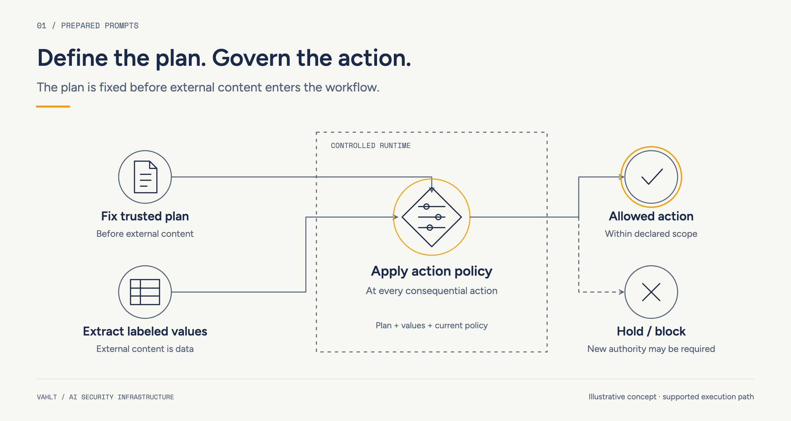
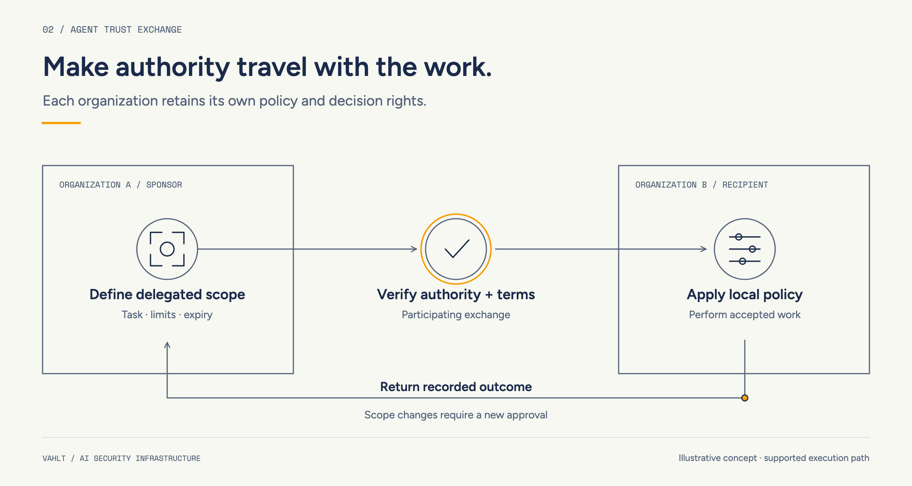

<picture>
  <source media="(prefers-color-scheme: dark)" srcset="https://raw.githubusercontent.com/vahlt-engine/.github/main/profile/assets/vahlt-wordmark-white.png">
  
</picture>

# VAHLT

**Security for AI that acts.**

VAHLT is Encapsa's AI security business, developing infrastructure for AI agents that read outside information, act on business systems, and work with other organizations. Our two flagship programs are **Prepared Prompts**, for governed AI execution, and **Agent Trust Exchange**, for authorized work across company boundaries.

Our focus is explicit authority before consequential actions, with evidence of the outcome.

**Private-beta research program:** we are beginning with controlled prototypes and scoped design partnerships. Neither flagship is generally available. Participation and implemented capabilities are agreed for each pilot.

[Discuss a VAHLT pilot with Encapsa](https://encapsa.ai/contact) · [Prepared Prompts](#prepared-prompts) · [Agent Trust Exchange](#agent-trust-exchange)

## Prepared Prompts

### Define the work before outside content enters

The Prepared Prompt engine is designed to establish a trusted, versioned workflow before processing external documents, messages, or tool results. A separate extraction component reads that material without tools and returns constrained values. Those values retain their source, integrity, and confidentiality labels.

An independent policy check then evaluates each consequential action: the operation, resolved arguments, destination, and current authority. Required approval binds to the exact action and version. A changed destination or material change in scope requires a new decision.

A reusable prompt or a valid data schema alone does not establish the action boundary. The research asks whether supported workflows can preserve useful completion while limiting the effects of prompt injection and other untrusted inputs.

**Example:** an accounts-payable agent prepares an invoice draft for a selected vendor. The test document asks it to replace the vendor's bank account. The intended controls preserve the permitted draft workflow while denying the unauthorized change.

<picture>
  <source media="(max-width: 600px) and (prefers-color-scheme: dark)" srcset="https://raw.githubusercontent.com/vahlt-engine/.github/main/profile/assets/prepared-prompts-mobile-dark.png">
  <source media="(max-width: 600px)" srcset="https://raw.githubusercontent.com/vahlt-engine/.github/main/profile/assets/prepared-prompts-mobile-light.png">
  <source media="(prefers-color-scheme: dark)" srcset="https://raw.githubusercontent.com/vahlt-engine/.github/main/profile/assets/prepared-prompts-desktop-dark.png">
  
</picture>

*Illustrative concept. Controls apply to the supported execution path.*

## Agent Trust Exchange

### Make authority explicit between organizations

Agent Trust Exchange is designed to connect a business request to scoped delegation, the receiving organization's independent acceptance, and evidence of the result. Each participant retains control over its own systems and commitments.

A proposed exchange identifies the task, counterparties, permitted information, limits, expiry, and completion evidence. Both sides accept the relevant terms and apply their own controls. Sender authorization does not compel the recipient to act, and discovering an agent does not establish its business authority.

The design distinguishes **confirmed**, **failed**, and **unknown** outcomes. An acknowledgment is different from completed work. After a timeout, the workflow should reconcile available authoritative state before retrying, rather than risk a duplicate effect.

**Example:** a buyer and supplier exchange a quote for an approved item. Revised quantity or delivery terms require renewed authorization. This illustrative pilot ends with an accepted quote and a non-binding draft order, without payment or a purchase commitment.

<picture>
  <source media="(max-width: 600px) and (prefers-color-scheme: dark)" srcset="https://raw.githubusercontent.com/vahlt-engine/.github/main/profile/assets/agent-trust-exchange-mobile-dark.png">
  <source media="(max-width: 600px)" srcset="https://raw.githubusercontent.com/vahlt-engine/.github/main/profile/assets/agent-trust-exchange-mobile-light.png">
  <source media="(prefers-color-scheme: dark)" srcset="https://raw.githubusercontent.com/vahlt-engine/.github/main/profile/assets/agent-trust-exchange-desktop-dark.png">
  
</picture>

*Illustrative concept. Each organization retains its own policy and decision authority.*

## Our security approach

We are developing both programs around four practical principles:

1. **Explicit authority.** Name the principal, permitted operation, resource, destination, limits, and expiry. Check current permissions at the action boundary.
2. **Independent enforcement.** Apply policy in the execution path outside the model. Agent instructions and Skills support the task; software controls enforce its boundaries.
3. **Preserved information boundaries.** Keep source and entitlement restrictions attached to derived values. A schema-valid value can still be wrong or remain confidential.
4. **Observable evidence and recovery.** Connect plans, policy decisions, approvals, attempted effects, and observed outcomes. Preserve uncertainty and route exceptions to an accountable owner.

The controlled execution path defines coverage. Our evaluation plan considers useful completion, prohibited effects, review burden, latency, and cost together. A successful demonstration or a clean test suite does not establish universal protection.

## Practical pilot designs

These are illustrative experiments using synthetic records and controlled destinations, not completed customer results.

| Workflow | Boundary to evaluate |
| --- | --- |
| **Invoice intake · Prepared Prompts** | Prepare an accounts-payable draft for a selected vendor; test attempted bank-detail changes and outbound disclosures. |
| **Marketing content · Prepared Prompts** | Prepare a reviewed CMS draft from outside material; keep publication, links, and destination changes within separately authorized scope. |
| **Supplier coordination · Agent Trust Exchange** | Exchange a scoped quote; test changed terms, expired authority, and uncertain outcomes without creating a duplicate commitment. |
| **Security evidence · Agent Trust Exchange** | Share approved vendor evidence with a named requester for an agreed purpose; test excessive requests and revocation of future controlled access. |

## Help shape the first workflows

We welcome enterprise workflow owners, security and platform engineers, agent builders, and business counterparties who can contribute a bounded task and review its results.

An initial engagement starts with one simple task, synthetic or specifically authorized data, narrowly permitted actions, and recorded events at instrumented boundaries. We establish ordinary successful execution before introducing hostile content, changed authority, failures, and conflicting evidence. Findings guide each decision to narrow or expand the scope.

Bring a process owner, a technical contact, representative examples, and a clear definition of allowed and prohibited effects. Agent Trust Exchange also needs a willing counterparty with its own decision authority.

**[Discuss a VAHLT pilot with Encapsa](https://encapsa.ai/contact).** Mention VAHLT and describe the workflow without sending credentials, private customer records, or sensitive security findings through a public GitHub issue.

## Questions

### Is VAHLT a prompt library?

Prepared Prompts describes an execution architecture: trusted plans, labeled values, and independent policy at consequential actions. It is more than a collection of prompt templates.

### Does VAHLT eliminate prompt injection?

No. We are investigating ways to constrain supported actions under explicit assumptions. Incorrect data, compromised trusted components, and actions outside the enforcement path still need controls and review.

### Are a public SDK or production runtime available?

This profile introduces the research programs. It does not announce a released SDK or production service. Any published software repository will state its own scope, maturity, and license.

---

**An Encapsa business.** Explore [Encapsa](https://encapsa.ai) and the [Encapsa GitHub organization](https://github.com/encapsa-ai).
